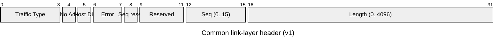

# Embedded 802.11 serial
Project is providing classic Radio Co-Processor solutions for [Zephyr](https://www.zephyrproject.org/) based micro-controllers.

There is an unique(ish) twist with the project where it can support multiplexing multiple protocols over the same serial interface reducing the need for peripheral devices and PCB draws.

The project shall support Linux and Zephyr host drivers.

There are no commercial or otherwise ambitions aims for the project outside seeing if this can be done in efficient manner using the most straight forward ways for the implementation. This is very much a hobby project and there is no timeline for finishing the tasks.

## Architecture
### General approach and technology choices
The project is optimized for Zephyr MCU for now. The wire-protocol between host and MCU is optimized for Zephyr North-bound Wi-Fi, Bluetooth Low-Energy (BLE) and OpenThread APIs.

There is a common header for the frames, but more complex technology specific protocols are defined through [Google Protobufs](https://protobuf.dev/) as the description language for now. Protobuf (De)serialization mechanism are well-understood, efficient and supported natively by Zephyr through [Nanopd](https://jpa.kapsi.fi/nanopb/docs/).

Linux kernel-driver is making the adaption under [cfg80211](https://www.kernel.org/doc/html/v4.12/driver-api/80211/cfg80211.html) API. As Zephyr Wi-Fi management API is based on full-MAC approach, cfg80211 is the most suitable starting point.

The solution has been defined serial interfaces in mind. In principle, any serial-like interface (SPI, SDIO, UART, USB ACM etc.) will work while the initial development focus is centered around USB to make development easier, but it is understood that the actual production implementations are going to be using SPI & SDIO.

C is used as the programming language across hosts and MCU software. Wonderful programming language [Rust](https://www.rust-lang.org/) is used everywhere else. I may consider using Rust for writing Linux kernel-driver if the bindings for cfg80211 are available for the language.

### Serial Medium Access Protocol (Serial MAC)
Serial MAC is providing means to manage the lowest level of interactions between the host and MCU including routing the packets between supported subsystems, abstracting the physical interfaces performing flow-control with serialization between the technology blocks.

The link protocol is defined as:

Diagram is supported in visualized format in later Mermaid plug-in.

Traffic Type can take following values:
- 0: Wi-Fi Management message
- 1: WiFi Data
- 2: Network L2 interface management
- 3: BT H4 message
- 4: OpenThread Spinel message
- 5: Network offloading (reserved)
- 6: AT-command (reserved)
- 7: Protocol information
- 8: Virtual serial interface

No Ack field is used for signaling if the sender would like to receive Ack for the message. In general, it is a good idea to use Ack, but in certain high-throughput use cases, it will advantageous to not send Ack for each frame. This feature will not be implemented in phase 1.

Host field provides direction metadata (host/device side) for the frame.

Error Type provides means to signal link-layer decisions. The technology specific error messages are sent as normal data transmissions. The defined error types are:
- 0: No Error
- 1: Incorrect sequence number
- 2: Out of buffers
- 3: Length too long (also used for unrecognized command)

Sequence Number is used for tracking in-order processing and acknowledgement over the link-layer. Sequence Number is 4-bit (0..15) and wraps after 15.

Ack is encoded as a regular link-layer header with the same traffic type, length 0, and error field indicating success/failure.

Length defines the length of the data after the header.

### WiFi management message

WiFi management messages start right after SMAC protocol. WiFi management messages are modeled through Zephyr WiFi management messages carried through in Google Protobuf messages. This streamlines serialization process in Zephyr device and host solution. Linux hosts have more processing power so they are more equipped to do tolerate extra overheads.

Heaving a separate traffic type for WiFi management and type enables simultaneous operations. For example, some calls maybe blocking in management side and that would block the parallel data transmission. Scan operation is one example of long lasting calls that should not block data transfers.

It can be assumed that there is only one WiFi device behind each serial link.

### WiFi Data

WiFi data includes the data being send out and received. WiFi data is exchanged using Ethernet II frames. Ethernet data is included right after SMAC header frame.

### BT H4 messages

BT H4 messages follow right after SMAC protocol. It is up to host BT stack to consolidate all BT packet types into H4 messages. This includes HCI Commands, ACL data, SCO/eSCO, Events and ISO Data.

It can be assumed that there is only one BT device behind each serial link.

### OpenThread Spinel message

OpenThread are specific for the implementation. HDLC framing is happening inside the Spinel protocol stack.

### Network offloading (reserved)

This feature is not implemented yet.

### AT-command (reserved)

This feature is not implemented yet.

### Virtual serial port

Virtual serial port is used for establishing virtual null-modem serials port in Zephyr device that manifest as another virtual serial port in the host side. This can be used by the system to push Zephyr logging information, expose Zephyr shell or any other kind of serial port driven functionality to the host.

Baudrate, bit-width, stop-bit, HW flow-control etc. values shall be shadows (when written, they can be read back having them being unchanged) to emulate real-serial port.

### System components
- `embedded80211/` — Zephyr module library. Contains the common link protocol,
  the device-side (co-processor) transport and technology proxies, and the
  Zephyr host-side drivers. Consumed via `ZEPHYR_EXTRA_MODULES`. Its `tests/`
  subdirectory holds the ztest protocol suite.
- `nrf7002dk/` — board project. The device-side Zephyr application for the
  nRF7002 DK (nRF5340 CPU app) that instantiates the `embedded80211` module in
  the device role.
- `host/` — QEMU host application. A Zephyr app for `qemu_cortex_m3` that
  instantiates the host-side drivers (virtual Wi-Fi, virtual Bluetooth HCI,
  link protocol bus) over a UART, plus an optional end-to-end test.
- `linux/` — Linux host integration (cfg80211-based), separate from the
  Zephyr host app. Phase 1–2 driver plan (protocol mapping, capability
  matrix, architecture) in [linux/README.md](linux/README.md).
- `cli_test/` — Rust command-line test harness that drives the link protocol
  over a serial port.
- `protos/` — protobuf schemas shared by the device and host builds
  (generated to nanopb at build time).

## System operations

### Initialization

When host is establishing the connection, it sends SMAC frame with traffic type "Protocol information" value 7 to which is receives the Device configuration packet. This is used for enumerate the necessary device drivers in Linux host or check that the configuration is matching in Zephyr host. In Zephyr host, the necessary drivers are established in built-time.

The uptime contains the time the device has been up since the last boot. This can be used for detecting if the device has reset.

### Link synchronization

Each traffic type to each direction has its own sequence number. In other words, host->device sequence number has not relation to device->host sequence number.

Sequence number starts from zero. If either party sends a packet with wrong sequence number, the other party shall response to that with error message. The sender of the wrong sequence number is responsible of resetting the sequence number by setting reset sequence number bit and placing the new sequence number into seq field.

Sender is responsible of resending the data in the case of error has occurred.

