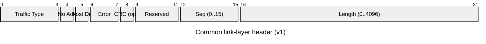
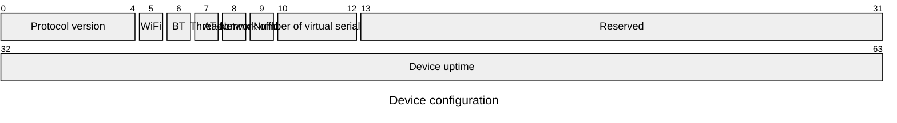
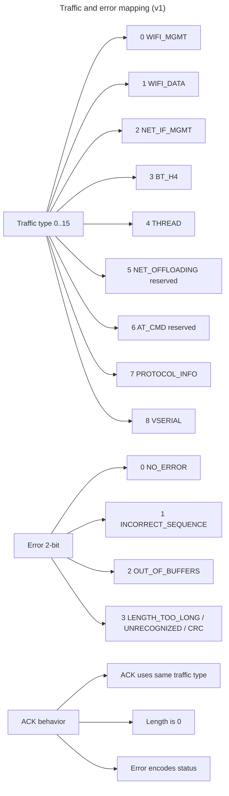

# Architecture

Living system blueprint for the Embedded 802.11 serial project. Keep this
document in sync when the architecture, module boundaries, wire protocol, or
host integrations change. Significant new technical trade-offs are recorded as
ADR in [decisions/](decisions/).

## 1. Overview

The project provides a Radio Co-Processor solution for Zephyr-based
microcontrollers. A Zephyr device app (co-processor role) exposes its Wi-Fi,
Bluetooth (BLE), and (reserved) OpenThread stacks to a host over one
multiplexed serial link, so a single serial interface serves all radio
technologies. Hosts can be Zephyr (reference implementation) or Linux
(cfg80211 driver, in planning).

It is a hobby project with no commercial aims; the goal is to see if this can
be done efficiently using the most straightforward implementation approaches.

## 2. Technology stack

| Area | Choice | Notes |
|------|--------|-------|
| Device firmware | C, Zephyr (NCS v3.4.1) | nRF7002 DK: nRF5340 app core + nRF70 radio core |
| Host (reference) | C, Zephyr | `qemu_cortex_m3` app + hardware over USB CDC-ACM |
| Host (Linux) | C, kernel cfg80211 driver | planning — see [../linux/README.md](../linux/README.md) |
| Tooling | Rust 2024 | `cli_test` CLI + integration tests |
| Schemas | Google Protobuf → nanopb | generated at build time; never committed |
| Development transport | USB CDC-ACM (VID `0x2FE3`) | two interfaces: `CDC_ACM_0` protocol bus, `CDC_ACM_1` spare |
| Production transports | SPI, SDIO | behind the same transport-agnostic layer |
| Diagnostics | SEGGER RTT | device logs; console vserial is silent by design |

## 3. Directory layout

| Path | Contents |
|------|----------|
| `embedded80211/` | Zephyr module library: common link protocol, device-side transport + technology proxies, Zephyr host-side drivers. Consumed via `ZEPHYR_EXTRA_MODULES`. `tests/` holds the ztest protocol suite. |
| `nrf7002dk/` | Board project: device-side Zephyr app for the nRF7002 DK (nRF5340 CPU app) instantiating the module in the device role. |
| `host/` | QEMU host application (`qemu_cortex_m3`): host-side drivers (virtual Wi-Fi, virtual Bluetooth HCI, link bus) over a UART, plus optional end-to-end test. |
| `linux/` | Linux host integration (cfg80211-based). Phase 1–2 driver plan in [../linux/README.md](../linux/README.md). |
| `cli_test/` | Rust command-line test harness driving the link protocol over a serial port. |
| `protos/` | Protobuf schemas shared by device and host builds (generated to nanopb at build time). |
| `docs/` | This blueprint, diagrams, and ADRs. |

## 4. Module boundaries

The `embedded80211` module is the single source of truth for the wire
protocol; definition of record is
[`embedded80211/zephyr/include/embedded80211/serial.h`](../embedded80211/zephyr/include/embedded80211/serial.h)
(protocol version 1, wire format is invariant).

Layering (bottom to top), each layer independently testable:

1. **Transport adapters** — UART, USB (CDC-ACM), SPI, SDIO-specific code.
   Kept behind the shared serial interface; no framing or sequence logic
   lives here.
2. **Multiplexer (link protocol)** — header framing, per-traffic-type
   routing, 4-bit sequence tracking, acknowledgement, flow control between
   technology blocks.
3. **Technology proxies** — one per domain, decoding/encoding payloads and
   calling Zephyr APIs:
   - `wifi_mgmt_proxy` — Wi-Fi management (protobuf) → Zephyr Wi-Fi mgmt APIs
   - `wifi_data` — Ethernet L2 frames following the common header directly
   - `net_if_mgmt_proxy` — network L2 interface management → Zephyr `net_if`
     APIs
   - `bt_proxy` — raw HCI (H4) to the SoftDevice Controller
   - `ot_proxy` — OpenThread Spinel (HDLC framing inside Spinel)
   - `vserial` — virtual null-modem serial port to the host
4. **Host drivers** — Zephyr host: `bus.c` (link bus client), `host_wifi.c`
   (virtual Wi-Fi ops), `host_bt.c` (virtual BT HCI). Linux host: cfg80211
   driver (planned).

Device and host roles are selected by Kconfig (`CONFIG_SERIAL_DEVICE_ROLE` /
`CONFIG_EMBEDDED80211_HOST_*`); a single build links exactly one role.

| Diagram | Source |
|---------|--------|
| MCU component overview (transports, multiplexer, proxies) | [mcu_component.png](mcu_component.png) / [mcu_component.puml](mcu_component.puml) |
| Wi-Fi data flow | [data_flow.png](data_flow.png) / [data_flow.puml](data_flow.puml) |
| Wi-Fi management request/response flow | [flow.png](flow.png) / [flow.puml](flow.puml) |
| Receive flow | [receive_flow.puml](receive_flow.puml) |
| Link-layer header visualization | [serial-bus-link.png](serial-bus-link.png) / [serial-bus-link.mmd](serial-bus-link.mmd), [protoviz_v1.svg](protoviz_v1.svg) (from [protoviz_v1.json](protoviz_v1.json)) |

## 5. Common link protocol (v1)

### 5.1 Frame header

The header is 64 bits (4 bytes) on the wire, big-endian:

- **Traffic Type** (4 bits): selects the technology subsystem.
- **No Ack** (1 bit): reserved. Not implemented in v1 — every frame is
  ACKed, so there is effectively one in-flight frame per direction.
- **Host Dir** (1 bit): direction metadata (`host=1` marks device→host
  frames).
- **Error** (2 bits): link-layer status (see 5.3).
- **CRC** (1 bit, bit 8): optional per-frame integrity. When set, a 4-byte
  CRC32C trailer follows the payload (see 5.7). Off by default; frames with
  the bit clear are byte-identical to the original v1 format.
- **Seq** (4 bits): 4-bit sequence number, 0..15, wraps after 15 (see 5.5).
- **Length** (16 bits): payload length, 0..4096 bytes. Payloads are
  32-bit aligned.

### 5.2 Traffic types

| Value | Traffic | Payload |
|-------|---------|---------|
| 0 | `WIFI_MGMT` | Protobuf `WifiMgmtRequest`/`Response`/`Notification` (`protos/wifi.proto`) |
| 1 | `WIFI_DATA` | Ethernet II frames, right after the header |
| 2 | `NET_IF_MGMT` | Protobuf mapping to Zephyr `net_if` administration (`protos/network_interface.proto`) |
| 3 | `BT_H4` | One H4 packet per frame, type byte first (1=command, 2=ACL, 3=event, 4=SCO); BLE only |
| 4 | `THREAD` | OpenThread Spinel (HDLC inside Spinel) |
| 5 | `NET_OFFLOADING` | reserved, not implemented |
| 6 | `AT_CMD` | reserved, not implemented |
| 7 | `PROTOCOL_INFO` | handshake, see 5.4 |
| 8 | `VSERIAL` | virtual serial bytes |

Separate traffic types for Wi-Fi management and Wi-Fi data allow simultaneous
operation: long-blocking management calls (e.g. scan) do not stall data
transfers.

It can be assumed there is one Wi-Fi device and one BT device behind each
serial link.

### 5.3 Errors and acknowledgements

| Value | Error |
|-------|-------|
| 0 | `NO_ERROR` |
| 1 | `INCORRECT_SEQUENCE` |
| 2 | `OUT_OF_BUFFERS` |
| 3 | `LENGTH_TOO_LONG` (also used for unrecognized command and CRC mismatch) |

- An ACK is a regular link-layer header with the same traffic type, length
  0, and the error field indicating success/failure.
- Technology-specific errors travel as normal data transmissions; the
  2-bit field only encodes link-layer decisions.
- On `INCORRECT_SEQUENCE`, the sender resyncs (resets its expected sequence
  to zero) and retries; resend behavior is explicit — the sender is
  responsible for resending after an error.
- `OUT_OF_BUFFERS` is a backpressure signal.
- `LENGTH_TOO_LONG` is the generic "frame not accepted" code. Beyond an
  oversize payload and an unrecognized traffic type, it is also the device's
  response to a **CRC32C mismatch**: the corrupted frame is dropped, the
  expected sequence is not advanced, and the sender re-syncs and retransmits
  (see 5.7).

### 5.4 Initialization

On connection the host sends a length-0 `PROTOCOL_INFO` query (no_ack). The
device answers with the 4-byte **device configuration** packet
`[version, mask_lo, mask_hi, next_seq]`, which consumes no sequence slot:

- The traffic-type mask lets the host enumerate drivers (Linux) or verify
  configuration (Zephyr); unsupported traffic types must fail clearly from
  this mask.
- The uptime (device seconds since last boot) can detect device resets.

### 5.5 Link synchronization

- Each traffic direction has its own sequence counter; host→device and
  device→host are independent and both start at zero.
- A frame with the wrong sequence number is answered with an
  `INCORRECT_SEQUENCE` error; the offending sender resets by setting the
  seq-reset bit with the new sequence number in the seq field.
- Suspend/resume, USB reset, and device-initiated resets must re-run the
  `PROTOCOL_INFO` handshake and resync sequence state.

### 5.6 Traffic and error mapping overview

### 5.7 Optional per-frame integrity (CRC32C)

The link is error-protected by an *optional* per-frame CRC32C trailer, enabled
independently by each endpoint at runtime. This is **not** a protocol-version
change: the feature is additive and off by default, so a peer that never
enables it sees frames byte-identical to the original v1 format.

- When the `crc` bit (header bit 8) is set, a 4-byte **big-endian CRC32C**
  (Castagnoli / iSCSI: polynomial `0x1EDC6F41`, reflected, init `0xFFFFFFFF`,
  final XOR `0xFFFFFFFF`) is appended after the payload.
- The CRC is computed over the 4-byte header **plus** the payload.
- A receiver verifies the trailer only when the bit is set. On a mismatch the
  frame is **dropped** (not decoded, not dispatched) and the expected
  sequence is **not** advanced; the receiver replies with an error ACK carrying
  the unchanged expected sequence so the sender re-syncs and retransmits.
- The device signals this rejection with the `LENGTH_TOO_LONG` error code
  (the generic "frame not accepted" code). The host bus and the Rust harness
  treat `LENGTH_TOO_LONG` like `INCORRECT_SEQUENCE` — exactly one resync +
  retry.
- Primitives, all producing the identical value (check vector
  `crc32c("123456789") = 0xE3069283`, pinned by unit tests on each side):
  Zephyr `crc32_c()`, Linux `crc32c()`, Rust `crc32c` crate.

See [decisions/](decisions/) for the ADR.

## 6. Technology payload rules

- **Wi-Fi management**: Zephyr Wi-Fi management messages in protobuf. The
  device proxy dispatches the `WifiMgmtRequest` types (connect, disconnect,
  scan, AP enable/disable, PS config, regulatory domain, interface status,
  versions, raw frame TX/RX); asynchronous results arrive as
  `WifiMgmtNotification` events. The response `request_id` is the
  RequestType — one outstanding request per type, serialized on the host.
- **Wi-Fi data**: Ethernet II frames directly after the common header, both
  directions. Device-side TX buffer is 1600 B, so the host must respect
  short writes / partial-frame boundaries and `OUT_OF_BUFFERS` backpressure.
- **Network-interface management**: Zephyr `net_if` administration in
  protobuf. The Linux driver uses it only for interface enumeration at
  probe; IP configuration stays in the Linux stack.
- **Bluetooth**: raw H4 (command/ACL/SCO/event) — no classic BT; the board
  is a transparent HCI pipe to the nRF5340 SoftDevice Controller on the
  network core.
- **OpenThread**: Spinel inside common frames; HDLC framing happens inside
  the Spinel stack.
- **Virtual serial**: a virtual null-modem port to the host, usable for
  Zephyr logging, shell, or other serial-driven functionality. Baud rate,
  stop bits, and parity are shadowed for readback compatibility only and do
  not control transport behavior.
- **Network offloading / AT commands**: reserved until implemented.

## 7. Host integrations

### 7.1 Zephyr host (reference implementation)

`host/` + `embedded80211/zephyr/host/` is the reference host: link bus
client (`bus_request` roundtrip), virtual Wi-Fi (`virt_wifi_ops`), and
virtual BT HCI over a UART under QEMU, plus the end-to-end test. Any host
implementation (e.g. the Linux driver) must pair with this reference
behavior.

### 7.2 Linux host (cfg80211)

Status: **planning**. Full-MAC cfg80211 driver (no mac80211), in-kernel
per-traffic-type ports, firmware-side crypto. Requirements, mapping tables,
capability matrix, risks, and the Phase 3–17 roadmap are in
[../linux/README.md](../linux/README.md).

### 7.3 Rust CLI harness

`cli_test/` drives the protocol from userspace over a serial port for manual
validation (scan, connect, AP, raw frame TX, regulatory domain, power save,
HCI commands) and runs hardware integration tests.

## 8. Non-negotiable constraints

- **Wire protocol is invariant**: 4-byte header layout, traffic types,
  sequence/ACK rules, and `PROTOCOL_INFO` response layout must not change
  without a protocol-version update and compatibility documentation
  (see root `AGENTS.md`).
- **Protobuf schema stability**: never renumber existing fields; additions
  use new field numbers; removed numbers are reserved where possible.
- **No PII/credentials in the repo**: E2E Wi-Fi credentials (SSID/PSK) are
  build-time arguments / environment variables only.
- **NCS local patches must persist** (re-apply after any fresh NCS install):
  - `zephyr/subsys/usb/device_next/class/usbd_cdc_acm.c` — CDC-ACM TX-drain
    patch (see [../nrf7002dk/README.md](../nrf7002dk/README.md))
  - `zephyr/drivers/wifi/nrf_wifi/src/net_if.c` — `nrf_wifi_start_zep_last_step`
    diagnostic markers
- **Untrusted input**: all serial/device-provided data is validated
  (lengths, alignment, traffic types, reserved bits, direction, sequence
  state, protocol version) before decoding.
- **Build constraints**: the NCS host app must build with `--no-sysbuild`;
  Kconfig warnings are hard errors; `qemu_cortex_m3` has 64 KB RAM, so
  net_buf/heap sizes stay small.

## 9. Decisions

Significant historical design choices and trade-offs are recorded as
architecture decision records in [decisions/](decisions/).
