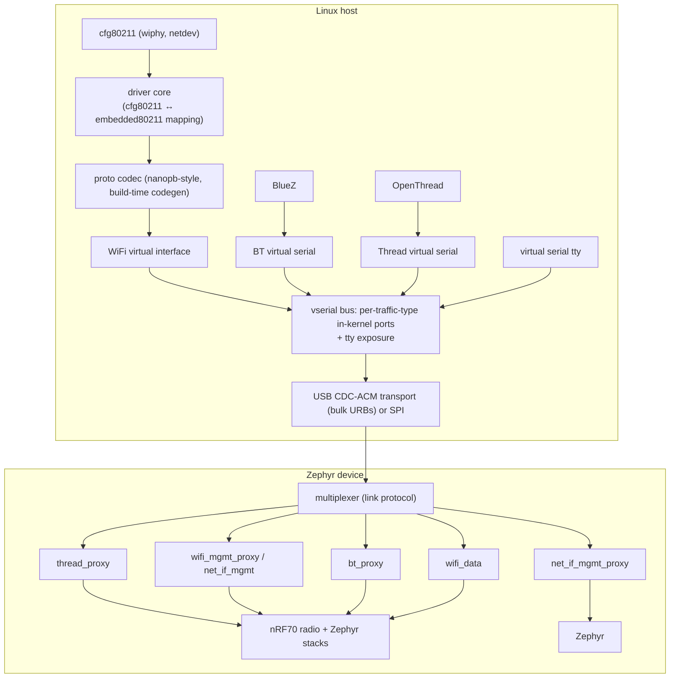

# Linux host integration (cfg80211)

Status: **planning**. This directory holds the plan for a Linux cfg80211 driver
against the `embedded80211` link protocol ("cfg80211_serial"). Phases 1–2 of the
driver mission — requirements discovery and Linux wireless architecture — are
complete and documented below (2026-11-10). Phases 3–17 are future work
([§4 Roadmap](#4-roadmap-phases-3-17)). No driver code exists yet; the
constraints in [AGENTS.md](AGENTS.md) apply to all of it.
## 1. Background: the cfg80211_serial link protocol

The device (nRF7002 DK: nRF5340 app core + nRF70 radio core, NCS v3.4.1) exposes
its Wi-Fi, Bluetooth, and (reserved) OpenThread stacks through one multiplexed
link protocol. Definition of record:
`embedded80211/zephyr/include/embedded80211/serial.h`
(protocol version 1, wire format is invariant).

- **Header** (4 bytes, wire order):
  `type(4) | no_ack(1) | host(1) | error(2) | crc(1) | reserved(3)`,
  `seq(4)`, `length(16)` big-endian; payload 0..4096 bytes. `host=1` marks
  device→host frames. When `crc` is set, a 4-byte big-endian CRC32C (Castagnoli,
  over header + payload) follows the payload — an optional, runtime-enabled
  integrity feature (off by default, so v1 peers are unaffected).
- **Traffic types**: 0 `WIFI_MGMT`, 1 `WIFI_DATA`, 2 `NET_IF_MGMT`, 3 `HCI`,
  4 `THREAD`, 5 `NET_OFFLOADING` (reserved), 6 `AT_CMD` (reserved),
  7 `PROTOCOL_INFO`, 8 `VSERIAL`.
- **Sequencing**: 4-bit seq, wraps at 15, independent per direction; the
  host→device seq is the authority for host→device ordering.
- **ACK**: a frame with the same traffic type, length 0, and an error field.
  `INCORRECT_SEQUENCE` → the sender resyncs (see below) and retries exactly once.
  `OUT_OF_BUFFERS` → backpressure signal. `LENGTH_TOO_LONG` also signals an
  unrecognized command **and** a CRC32C mismatch (corrupted frame dropped,
  sequence not advanced, sender retransmits).
- **Handshake**: `PROTOCOL_INFO` is a length-0 query (`no_ack`); the 4-byte
  response is `[version, mask_lo, mask_hi, next_seq]` and consumes no sequence
  slot. Unsupported traffic types must fail clearly from this mask.
- **`no_ack` is not implemented in protocol v1**: every frame is ACKed, so
  there is effectively one in-flight frame per direction.

USB CDC-ACM (VID `0x2FE3`; `CDC_ACM_0` = protocol bus, `CDC_ACM_1` spare) is the
development transport. Production targets are SDIO/SPI; the Linux transport
layer must stay transport-agnostic (R6).

The Zephyr host application (`host/` + `embedded80211/zephyr/host/`) is the
reference host implementation and the pairing target for this driver.

## 2. Phase 1 — Requirements discovery

### 2.1 Firmware (radio co-processor) capabilities

- **Full-MAC**: the radio core runs a complete 802.11 Zephyr stack (eg. `nrf_wifi`
  on NCS v3.4.1). 802.11↔Ethernet conversion, scanning, authentication/
  association, 4-way handshake, and **all crypto** happen in firmware. The host
  sees Ethernet L2 frames plus management commands.
- **Bands**: 2.4 GHz + 5 GHz. The proto also defines 6 GHz; the nRF70 does not
  support it — capability advertising must exclude it.
- **Security**: open, WEP, WPA2-PSK (CCMP), WPA3-SAE, PMF (MFP optional/
  required). Enterprise/EAP is enumerated in the proto but has no working
  credential path in firmware today (R5).
- **AP mode**: the full proto surface exists, but the NCS `nrf_wifi` driver
  returns `-ENOTSUP` for AP enable on this board → out of MVP (R4).
- **BLE**: SoftDevice Controller on the network core; raw HCI (H4) is exposed
  over the link. No classic Bluetooth.
- **Raw-frame test path** (`wifi_data.c`): raw TX via `NRF_WIFI_MAGIC_NUM_RAWTX`
  (24..2346 B, FCS appended in firmware) and raw/monitor RX — used for data
  loopback tests, not a product feature.

**Upstream status** (verified 2026-11-09): `drivers/net/wireless/nordic` does
not exist in torvalds/linux master — there is no in-tree nRF700 driver to base
this on.

### 2.2 Protocol surface

`WIFI_MGMT` frames carry `WifiMgmtRequest` / `WifiMgmtResponse` /
`WifiMgmtNotification` (`protos/wifi.proto`). The device proxy
(`embedded80211/zephyr/device/wifi_mgmt_proxy.c`) dispatches 15 RequestTypes:

| ID | Request | Response payload |
|----|---------|------------------|
| 1 | `CONNECT` — `WifiConnectRequest` | `WifiStatusResponse` (result via event) |
| 2 | `DISCONNECT` — `WifiDisconnectRequest` | `WifiStatusResponse` (result via event) |
| 3 | `SCAN` — `WifiScanRequest{params}` | `WifiStatusResponse` (results via event) |
| 4 | `AP_ENABLE` — `WifiApEnableRequest` | `WifiStatusResponse` (result via event) |
| 5 | `AP_DISABLE` — `WifiApDisableRequest` | `WifiStatusResponse` (result via event) |
| 6 | `GET_WIFI_VERSION` | driver/firmware version |
| 7 | `SET_PS_CONFIG` — `WifiPsSettings` | `WifiStatusResponse` |
| 8 | `GET_PS_CONFIG` | `WifiPsSettings` |
| 9 | `SET_REG_DOMAIN` — `WifiRegDomain` | `WifiStatusResponse` |
| 10 | `GET_REG_DOMAIN` | `WifiRegDomain{country, force, channel_info[]}` |
| 11 | `GET_IFACE_STATUS` | `WifiInterfaceStatus` |
| 12 | `GET_PROTOCOL_VERSION` | `[major, minor]` |
| 13 | `SEND_RAW_FRAME` — raw 802.11 bytes | `WifiStatusResponse` |
| 14 | `ENABLE_RAW_RX` — channel | monitor-mode status |
| 15 | `DISABLE_RAW_RX` | `WifiStatusResponse` |

**Events** (`WifiEvent` oneof, device→host, `WIFI_MGMT`): `scan_done`
(status + batched `all_results[]`), `connect_result`, `disconnect_result`
(`initiated_by_user`, `reason_code`), `interface_status`, `ap_enable_result`,
`ap_disable_result`, `ap_sta_connected`, `ap_sta_disconnected`, `raw_frame_rx`.

**Correlation**: the response's `request_id` is the RequestType — one
outstanding request per type. The driver must serialize per type, the same
model as the Zephyr host's synchronous `bus_request` roundtrip.

Other traffic types the driver consumes:

- `NET_IF_MGMT`: 37-request oneof mapping to Zephyr `net_if` administration.
  The Linux driver uses it **only** for interface enumeration at probe (device
  iface index, MAC, MTU); IP configuration stays in the Linux stack.
- `HCI`: one H4 packet per link frame, type byte first (1=command, 2=ACL,
  3=event, 4=SCO). BLE only.
- `VSERIAL`: console bytes (see §3.6).

### 2.3 Mapping table: firmware primitive → cfg80211 callback → driver implementation

The mac80211 column is empty by design (full-MAC, D1):

| Firmware primitive (cfg80211_serial) | cfg80211 callback | Driver implementation |
|---|---|---|
| `PROTOCOL_INFO` handshake; `GET_PROTOCOL_VERSION`(12), `GET_WIFI_VERSION`(6); NET_IF interface enumeration | probe / wiphy registration | capability mask gates traffic types; learn device iface index + MAC (D7); advertise bands/channels/ciphers from `GET_REG_DOMAIN` + static nRF70 capability |
| `SCAN`(3) `WifiScanParams{scan_type, bands, dwell_*, ssids[], band_chan[]}` | `.scan_start` | roundtrip; active/passive; directed via `ssids[]` |
| event `scan_done{status, all_results[]}` | `cfg80211_scan_done` | batched results, **no IEs** → driver fabricates a minimal `cfg80211_bss` per result (R2) |
| `CONNECT`(1) `WifiConnectRequest`; events `connect_result{status}` + `interface_status` | `.connect` | firmware runs auth/assoc/4-way; completion via events; assoc response synthesized (D10, R1) |
| `DISCONNECT`(2); event `disconnect_result{initiated_by_user, reason_code}` | `.disconnect` | roundtrip + event; unsolicited disconnect → `cfg80211_disconnected` with `reason_code` |
| `SET_PS_CONFIG`(7) / `GET_PS_CONFIG`(8) `WifiPsSettings` + `WifiPowerSaveType` | `.set_power_mgmt` / `.get_power_mgmt` | direct mapping (listen interval, PS type) |
| `SET_REG_DOMAIN`(9) / `GET_REG_DOMAIN`(10) `WifiRegDomain` | regulatory domain | driver maps `passive_only`/`dfs` per channel into `cfg80211` channel flags (D12); country from device |
| `GET_IFACE_STATUS`(11) + `interface_status_event` | link info / signal poll, debugfs | rssi, channel, bitrates, mcs, state |
| `AP_ENABLE`(4) / `AP_DISABLE`(5) + AP result/sta events | `.start_ap` / `.stop_ap` / `.change_virtual_intf` | **out of MVP** (firmware `-ENOTSUP`, R4) |
| `SEND_RAW_FRAME`(13) / `ENABLE_RAW_RX`(14) / `DISABLE_RAW_RX`(15) + `raw_frame_rx_event` | `.mgmt_tx` / `.remain_on_channel` (emulation only) | test path in MVP; ROC emulation candidate later |
| `WIFI_DATA` frame (Ethernet L2, ≤4096 B) | netdev `hard_start_xmit` / `netif_rx` | data TX/RX, §3.4 |
| `HCI` (H4) | Bluetooth core HCI | §3.5 |
| `VSERIAL` | console tty | §3.6 |

### 2.4 Parameter conversion and parameters that terminate in the driver

Direct conversions (proto enum ↔ cfg80211):

- Bands: `WIFI_BAND_2_4_GHZ/5_GHZ` ↔ `NL80211_BAND_2GHZ/5GHZ` (6 GHz excluded).
- Channels: raw 802.11 channel numbers in both domains — no conversion.
- Security: `NONE/WEP/PSK/SAE` ↔ open/WEP/CCMP/SAE; MFP via `WifiMfpOptions`.
  PSK-SHA256 and enterprise variants are advertised only if firmware confirms
  support (R5).
- RSSI: `int32` dBm in both domains.
- Status codes: negative Zephyr errno → Linux `-E*` mapping table in the codec
  layer.
- `eap_*` connect fields: Zephyr-side supplicant artifacts; terminate in the
  Linux driver, never sent.

Parameters that **terminate in the Linux driver** (accepted by cfg80211, never
placed on the wire):

- Scan: `ie`/`ie_len`, `no_probe_mask`, `report_interval`.
- Connect: `ie`/`ie_len`, `wpa_keys` (pairwise/group), `pmk` (no proto field),
  most `CONNECT_*` flags (mapped implicitly by security/MFP selection).
- **All key management** (`add_key`/`del_key`/`get_key`/`set_key`): crypto is
  in firmware (D11); the driver does not install keys.
- No primitive in MVP → `-EOPNOTSUPP`: `mgmt_tx`, `remain_on_channel`,
  `set_tx_power`, `get_station`, AP beacon parameters.

### 2.5 Capability matrix

| Capability | Firmware/proto | cfg80211 op | MVP |
|---|---|---|---|
| Scan (active/passive/directed) | `SCAN` + `scan_done` | `.scan_start` | yes |
| STA connect open/WEP/PSK/SAE + PMF | `CONNECT` + `connect_result` | `.connect` | yes |
| Disconnect (local + link-loss) | `DISCONNECT` + `disconnect_result` | `.disconnect` | yes |
| Data path (Ethernet, both directions) | `WIFI_DATA` | netdev xmit/rx | yes |
| Power save config | `SET/GET_PS_CONFIG` | `.set/get_power_mgmt` | yes |
| Regulatory domain get/set | `SET/GET_REG_DOMAIN` | reg domain | yes |
| Interface status / signal | `GET_IFACE_STATUS` + event | poll/debugfs | yes |
| Driver/firmware version | `GET_WIFI_VERSION` | debugfs | yes |
| Link protocol/version handshake | `PROTOCOL_INFO`, `GET_PROTOCOL_VERSION` | probe | yes |
| AP mode | proto complete; firmware `-ENOTSUP` | `.start_ap` | no (R4) |
| Enterprise/EAP | proto fields only | `.connect` (EAP) | no (R5) |
| Management RX (assoc resp, deauth) | none — synthesized | `mgmt_rx` path | emulated (D10, R1) |
| Remain-on-channel | none (raw-RX emulation candidate) | `.remain_on_channel` | no |
| TX power set/get | none | `.set_tx_power` | no |
| Station stats | none | `.get_station` | no |
| TWT | `twt_capable` field only | `.set_twt` | no |
| 6 GHz | proto enum only | bands | no |
| DFS/CAC | `dfs` flag in reg info; CAC unverified in firmware | reg flags | partial (flag pass-through only) |

### 2.6 MVP scope

STA only, single virtual interface (D8), netdev MTU 1500 with the MAC taken
from the device (D9):

- Probe: `PROTOCOL_INFO` handshake + `GET_PROTOCOL_VERSION` +
  `GET_WIFI_VERSION` + NET_IF interface enumeration; wiphy registration.
- Operations: `SCAN`, `CONNECT` (open/WEP/PSK/SAE), `DISCONNECT`,
  `GET_IFACE_STATUS`, `GET_REG_DOMAIN`, `SET/GET_PS_CONFIG`.
- Events: `scan_done`, `connect_result`, `disconnect_result`,
  `interface_status`.
- Data: `WIFI_DATA` both directions.
- Debugfs: version, interface status, link/statistics counters.
- Security: all in firmware (D11); the driver exposes cipher suites as
  capability only.

### 2.7 Missing primitives and schema extensions

Additions need new field/enum numbers (never renumber; AGENTS.md). Proposed
assignments:

1. `SCAN_ABORT = 16`
2. ROC start/stop = 17/18 + `RocResultEvent`
3. TX power set/get = 19/20
4. EAPOL forwarding / enterprise credential path
5. Beacon IE bytes in `WifiScanResult` (field 9)
6. Group-key rekey notification event
7. STA statistics (`get_station`)
8. AP beacon ownership resolution (firmware fix for R4)
9. TWT setup
10. `MgmtRxEvent` (assoc response frame) = `WifiEvent` oneof field 11
11. Firmware reset event
12. CSA (AP)

## 3. Phase 2 — Linux wireless architecture

### 3.1 SoftMAC vs full-MAC: full-MAC cfg80211 (D1)

The firmware contains a complete WLAN stack, so **mac80211 is not used**.
mac80211 would duplicate in the kernel what the radio core already does, and
the device exposes Ethernet (plus a raw-frame test path), not an 802.11 frame
interface. The driver is a cfg80211 full-MAC driver with its own Ethernet
netdev — the same class as `ipw2200` (full-MAC, firmware auth) and `brcmfmac`
(full-MAC SDIO/USB, management frames from firmware).

### 3.2 Layered stack and Zephyr pairing



The layers satisfy `linux/AGENTS.md`: serial framing never leaks into
cfg80211 callbacks; transport, framing, protobuf, and cfg80211 registration
are separate layers with explicit ownership.

Zephyr device is board agnostic. Thus any board will work with the same Linux driver.

Pairing with the Zephyr host implementation (same protocol, same device):

| Zephyr host (`embedded80211/zephyr/host/`) | Linux driver |
|---|---|
| `bus_register_handler(type, cb)` | in-kernel port registration per traffic type |
| `bus_request` roundtrip | `fw_ops` request/response roundtrip |
| `virt_wifi_ops` (scan/connect/AP/PS/reg) | `cfg80211_ops` |
| `virt_wifi_l2_send` / `wifi_data_rx` net_pkt path | netdev `hard_start_xmit` / `netif_rx` |
| `bt_hci_driver_api` (H4) | BlueZ `hciattach` (option A) / in-kernel HCI registration (option B) |

### 3.3 Port model (D3, D4, D6)

The multiplexed link is exposed as **in-kernel ports, one per traffic type**,
plus a tty per port:

- The Wi-Fi driver claims three ports exclusively: `wifi-mgmt` (protobuf
  roundtrips + events), `wifi-data` (Ethernet frames) and 'net-if-mgmt'.
- `hci` port → Bluetooth path (§3.5); `vserial` port → console tty (D6).
- Exclusive ownership: only one consumer per port (the Wi-Fi driver for the
  Wi-Fi ports, BlueZ for HCI). A tty bound to a claimed port fails open.
- The USB device driver claims the composite CDC-ACM device with ftdi_sio-style
  parent matching (D4), not per-interface `cdc_acm` binding — this keeps the
  claim explicit and avoids cdc_acm's tty/claiming interference (R7).
- Unsupported traffic types (from the `PROTOCOL_INFO` mask) fail clearly at
  port open, per `linux/AGENTS.md`.

### 3.4 Wi-Fi data path (D1, D9)

TX: netdev `hard_start_xmit` → skb to driver queue → link frame (`WIFI_DATA`)
→ bulk OUT URB → device. RX: bulk IN URB → link frame → `netif_rx()`.

- Frames are Ethernet L2, ≤4096 B (32-bit aligned payloads); device-side TX
  buffer is 1600 B, so the driver must respect short writes / partial-frame
  boundaries and the link's `OUT_OF_BUFFERS` backpressure.
- With protocol v1's one-in-flight ACK scheme, the data path is throughput-
  limited (R3); queue depth and coalescing are Phase 16 concerns. The
  transport layer is designed so a higher-throughput link revision (no_ack)
  drops in without API changes.
- Suspend/resume and removal must drain/flush in-flight frames; teardown with
  in-flight requests is safe per `linux/AGENTS.md`.

### 3.5 Bluetooth path (D5)

```
BlueZ
  ↓
HCI (H4 over the multiplexed HCI port)
  ↓
vserial bus → USB CDC-ACM → device multiplexer → bt_proxy → nRF70 (BLE)
```

- **Option A (MVP)**: expose the `hci` port as a tty; `hciattach` from
  userspace. Zero in-kernel Bluetooth code; BLE-only H4 matches what
  `bt_proxy.c` already provides.
- **Option B (upstream target)**: in-kernel HCI driver that demuxes H4 from
  the link port and registers an `hci_dev` with the Bluetooth core (the
  `hci_uart` equivalent, minus the UART).
- Tradeoff: A is fastest to a working `bluetoothctl scan` and proves the
  device side; B is required for upstream acceptance and removes the userspace
  hop. The port abstraction makes A → B a transport-swap, not a rewrite.
- Coexistence with Wi-Fi is managed on the device (shared nRF70 silicon);
  the Linux driver is unaware of it.

### 3.6 VSERIAL / console (D6)

The `VSERIAL` port is a plain console tty (device logs). Baud/stop/parity are
shadowed for readback compatibility only and do not affect transport behavior
(protocol rule). The device's real log console is vserial (silent by design on
the DK; RTT is used for development logs), so this port is best-effort and
never on the Wi-Fi critical path.

### 3.7 USB transport notes (Phase 5 preview, D4)

- **Endpoint discovery**: parse the CDC-ACM interface descriptors; identify
  bulk IN / bulk OUT endpoints per interface; `CDC_ACM_0` carries the
  multiplexed link, `CDC_ACM_1` is the spare/console interface.
- **URB design**: a small pool of IN URBs (ring) + OUT URBs per direction;
  link frames are reassembled across URBs (frames do not align to URB
  boundaries); `serial.h` framing is the single source of truth for
  reassembly.
- **Power management**: autosuspend + runtime PM; the link's ACK scheme makes
  a quiet line a valid idle signal (no in-flight frame ⇒ suspendable).
- **Reset/recovery**: USB reset and device-initiated resets must re-run the
  `PROTOCOL_INFO` handshake and resync sequence state (R8).
- Production transports (SDIO/SPI) sit behind the same transport interface.

### 3.8 Risks and open issues

| # | Risk | Mitigation |
|---|---|---|
| R1 | No management-frame RX from firmware (assoc response, deauth) | synthesize assoc/deauth events from `connect_result`/`disconnect_result` (D10, ipw2200 style); `MgmtRxEvent` extension on the roadmap |
| R2 | Scan results carry no IEs (SSID/BSSID/RSSI/security only) | driver fabricates minimal `cfg80211_bss`; beacon-IE extension (roadmap 5) for full `iw scan` output |
| R3 | One in-flight frame per direction (v1 ACK scheme) caps throughput | accept for dev; no_ack revision is transport-compatible |
| R4 | AP mode `-ENOTSUP` in NCS `nrf_wifi` + beacon ownership unresolved | out of MVP; firmware fix tracked (roadmap 8) |
| R5 | No working EAP/enterprise credential path | open/WEP/PSK/SAE only in MVP; EAPOL forwarding on the roadmap |
| R6 | USB is a dev transport; production is SDIO/SPI | transport-agnostic layer (D4) |
| R7 | `cdc_acm` interface claiming conflicts with a dedicated driver | dedicated driver claims the composite device (D4, ftdi_sio-style) |
| R8 | Firmware/USB reset recovery with in-flight requests | handshake resync + bounded request timeouts + teardown drain |
| R9 | Linux seq/ACK state machine must match the device exactly | reuse the ztest vectors (`embedded80211/tests/`) as a shared test corpus |
| R10 | Kernel API drift (mission targets 7.0; cfg80211 APIs move) | pin a kernel at Phase 3; re-validate cfg80211/USB APIs before Phase 8 |
| R11 | No nanopb in-kernel; protobuf codegen toolchain needed | build-time codegen producing kernel-safe C (no libc), or a handwritten codec for the two schemas; decided at Phase 6 |

## 4. Roadmap (Phases 3–17)

Outline only — detailed per-phase deliverables follow from this plan:

3. **Environment**: mainline kernel tree + `CFG80211`, `USB`, `KASAN`,
   `KMEMLEAK`, `LOCKDEP`, `DYNAMIC_DEBUG`; userspace tools (`iw`,
   `wpa_supplicant`, `hostapd`, `usbmon`, `tcpdump`, `iperf3`).
4. **Driver skeleton**: `drivers/net/wireless/<vendor>/<device>/`
   (`main`, `usb`, `cfg80211`, `tx`, `rx`, `fw`, `debugfs`, `trace`).
5. **USB transport**: endpoint discovery, URB pools, backpressure,
   suspend/resume, reset recovery (§3.7).
6. **Firmware abstraction**: `fw_ops` wrapping every proto message; no
   cfg80211 code touches the wire format; codec toolchain decision (R11).
7. **Primitive mapping**: implement §2.3 table; fill gaps per §2.7.
8. **cfg80211 implementation**: wiphy registration + MVP ops (§2.6).
9. **mac80211**: not applicable (D1).
10. **Data path**: §3.4, with ztest-based framing tests.
11. **Management frames**: synthesized events (D10) → `MgmtRxEvent` when the
    firmware extension lands.
12. **Security**: firmware crypto (D11); advertise suites; no host key
    install.
13. **Regulatory**: `WifiRegDomain` → cfg80211 reg API (D12); DFS flags
    pass-through, CAC only if firmware gains it.
14. **Debug/tracing**: debugfs (version, status, counters) + tracepoints
    (tx/rx/scan/fw-command/fw-event/usb-error).
15. **Testing**: usbmon frame checks, `iw` matrix (scan/connect/disconnect/
    AP/WPA), iperf3 throughput, probe/remove/timeout/reset/malformed/
    sequence-recovery/concurrency paths (`linux/AGENTS.md`).
16. **Performance**: URB batching, RX refill, skb allocation, queue depth;
    no_ack link revision.
17. **Upstream readiness**: checkpatch/sparse/smatch, split patch series
    (core → usb → fw-abi → cfg80211 → data path → debugfs), vendor-neutral
    naming review.
